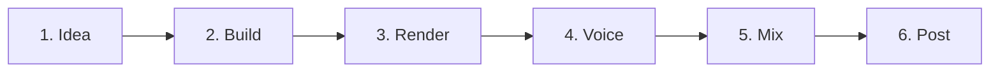

# Simple Guide

No coding knowledge needed. What this project is, and how a video gets made.

## What is this?

A folder that makes **Instagram Reels and YouTube videos using code instead of a video editor**.

Think of a video as a slideshow written in text. Change the words, press a button, get a new video. Same look every time.

## What videos are in here?

Short videos explaining OptionXi:

- What OptionXi is (app intro)
- How it works (with an animated presenter)
- Features: market mood, stock research, screeners, volume jumps
- How we build OptionXi with AI and open-source it
- A YouTube channel intro

Links to watch them are in the [main README](./README.md#videos).

## How a video is made (6 steps)



1. **Idea**: decide what the video says. Ask AI for a short script first. Approve it.
2. **Build**: AI writes the video code. We preview it and tweak.
3. **Render**: the computer turns the code into a video file (mp4).
4. **Voice**: turn the script into a voiceover (ElevenLabs).
5. **Mix**: join video + voice in an editor, add captions.
6. **Post**: upload to Instagram and YouTube.

## Things to know

- **One file per video.** Each video has its own file with its own settings (length, size, speed). Change words and timing there.
- **Safe area.** Instagram hides parts of the screen with buttons and captions. One shared file keeps all text and pictures inside the visible middle, so nothing gets covered. While editing you see a pink dashed box showing that area.
- **Avatar.** Some videos have an animated presenter who waves, points and talks.
- **Style skills.** Saved "look and feel" notes (colors, fonts, motion) that we give the AI so new videos match.

## Try it yourself

1. Install [Node.js](https://nodejs.org) (18 or newer).
2. Open a terminal in this folder.
3. Run:
   ```
   npm install
   npm run dev
   ```
4. A preview opens in your browser. Pick a video on the left and press play.

## Make the video file

```
npx remotion render src/index.ts <VideoName> out/my-video.mp4
```

Your video appears in the `out` folder. (`<VideoName>` is the name shown in the preview's left list.)

> Before rendering, open `src/shared/safe-area.tsx` and set `DEBUG_SAFE = false`, or the pink box shows up in the video.

## Make a new video with AI

1. Open `src/Avatar - Prompting/`.
2. Use the prompt in `README to generate videos using template and skill.md`.
3. Describe your topic in plain words. Ask for the script first.
4. Approve the script, then get the video file, add it to `src/Root.tsx`.

## Stuck?

See [Troubleshooting](./README.md#troubleshooting) in the main README.
