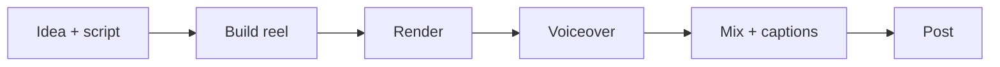

<div align="center">

# OptionXi Reels

**Instagram + YouTube videos for [OptionXi](https://optionxi.com), written as code.**
Built with [Remotion](https://www.remotion.dev/) (React + TypeScript). Edit, preview, render, post.


</div>

> New here? Start with the **[Simple Guide](./GUIDE.md)**. No coding needed.

---

## Contents

- [Videos](#videos)
- [Quick start](#quick-start)
- [Rendering](#rendering)
- [Project structure](#project-structure)
- [How a reel is wired](#how-a-reel-is-wired)
- [Safe area](#safe-area)
- [Avatar](#avatar)
- [Workflow](#workflow)
- [Prompts and style skills](#prompts-and-style-skills)
- [Sound effects](#sound-effects)
- [Adding a new reel](#adding-a-new-reel)
- [Tips](#tips)
- [Troubleshooting](#troubleshooting)
- [License](#license)

---

## Videos

Each reel lives in its own file and exports its own `config`.

| Reel | Topic | Source | Instagram | YouTube |
|---|---|---|---|---|
| App Intro (v1, v2, **v3 active**) | What OptionXi is | [`src/Reels - App Intro/`](<./src/Reels - App Intro>) | [Watch](INSTAGRAM_LINK) | [Watch](YOUTUBE_LINK) |
| Avatar: How it works (v1, v2) | How OptionXi works, presented by an avatar | [`src/Reels - Avatar How it works/`](<./src/Reels - Avatar How it works>) | [Watch](INSTAGRAM_LINK) | [Watch](YOUTUBE_LINK) |
| Market Sentiment | Market mood feature | [`Reel-Market Sentiment.tsx`](<./src/Reels - App Features/Reel-Market Sentiment.tsx>) | [Watch](INSTAGRAM_LINK) | [Watch](YOUTUBE_LINK) |
| Stock Research | Per-stock research and AI analytics | [`Reel-Stock Research.tsx`](<./src/Reels - App Features/Reel-Stock Research.tsx>) | [Watch](INSTAGRAM_LINK) | [Watch](YOUTUBE_LINK) |
| Screeners | AI picks, ready-made, custom screeners | [`Reel-Screeners.tsx`](<./src/Reels - App Features/Reel-Screeners.tsx>) | [Watch](INSTAGRAM_LINK) | [Watch](YOUTUBE_LINK) |
| Stock Screeners Pro | Screeners Pro feature | [`Reel-Stock Screeners Pro.tsx`](<./src/Reels - App Features/Reel-Stock Screeners Pro.tsx>) | [Watch](INSTAGRAM_LINK) | [Watch](YOUTUBE_LINK) |
| Stock Volume Jump | Volume jump scanner, history, custom parameters | [`Reel-Stock Volume Jump.tsx`](<./src/Reels - App Features/Reel-Stock Volume Jump.tsx>) | [Watch](INSTAGRAM_LINK) | [Watch](YOUTUBE_LINK) |
| Build Publicly | How I build with AI and open-source it | [`src/Reels- Build Publically/`](<./src/Reels- Build Publically>) | [Watch](INSTAGRAM_LINK) | [Watch](YOUTUBE_LINK) |
| YouTube Intro | Channel intro (landscape) | [`Youtube-Intro.tsx`](./src/Youtube/Youtube-Intro.tsx) | n/a | [Watch](YOUTUBE_LINK) |

- Reels: 9:16, 1080 x 1920. YouTube: landscape. Each reel's size, fps and length are in its own `config`.
- Final renders go to [GitHub Releases](../../releases), never committed. One tag per video, e.g. `v001-intro`.

## Quick start

**Requirements:** Node.js 18+, npm, recent Chrome (Remotion downloads one if missing).

```bash
git clone https://github.com/optionxi/optionxi-reels.git
cd optionxi-reels
npm install
npm run dev          # Remotion Studio, live preview
```

| Command | What it does |
|---|---|
| `npm run dev` | Open Remotion Studio |
| `npm run typecheck` | Type check |

## Rendering

The composition ID is the one registered in `src/Root.tsx`.

```bash
# Full quality
npx remotion render src/index.ts <CompositionId> out/<CompositionId>.mp4

# Smaller file (higher CRF = smaller, lower quality)
npx remotion render src/index.ts <CompositionId> out/small.mp4 --crf=28

# One frame (thumbnail / layout check)
npx remotion still src/index.ts <CompositionId> out/frame.png --frame=300
```

Renders land in `out/` (git-ignored).

## Project structure

```
optionxi-reels/
├── public/
│   └── sfx/                          # Sound effects (whoosh, pop, tick, type, click, ding, success, hit)
├── safe-screen/
│   └── instagram-reels-safe-zone.png # Overlay for the Premiere safe-zone check
├── src/
│   ├── index.ts                      # Remotion entry
│   ├── Root.tsx                      # Registers every reel as a <Composition>
│   ├── shared/
│   │   └── safe-area.tsx             # Safe-area config + helpers (used by all reels)
│   ├── Avatar/                       # Presenter avatar rigs + README
│   ├── Avatar - Prompting/           # Prompts, style specs and skills for generating reels
│   ├── Reels - App Intro/            # Intro reels (v1, v2, v3)
│   ├── Reels - App Features/         # Market Sentiment, Stock Research, Screeners,
│   │                                 # Screeners Pro, Volume Jump
│   ├── Reels - Avatar How it works/  # Avatar explainer (v1, v2)
│   ├── Reels- Build Publically/      # Build-in-public reel
│   └── Youtube/                      # YouTube intro
├── remotion.config.ts
├── package.json
└── tsconfig.json
```

## How a reel is wired

Every reel file exports two things: the **component** and its own **`config`** (size, fps, length).

```tsx
// inside a reel file
export const config = {
  durationInFrames: 900,
  fps: 30,
  width: 1080,
  height: 1920,
};
const SAFE = getSafe(config);
```

`Root.tsx` imports each reel with its config and spreads it into a `<Composition>`:

```tsx
import ReelAppIntroV3, { config as configAppIntroV3 } from "./Reels - App Intro/Reel-Intro-v3";

<Composition id="OptionXiReel" component={ReelAppIntroV3} {...configAppIntroV3} />
```

The first composition in `Root.tsx` is the **active reel** shown first in Studio. Others are kept for quick switching.

## Safe area

Instagram covers the top (header), bottom (caption) and right (buttons) of a reel. All reels use one shared config: [`src/shared/safe-area.tsx`](./src/shared/safe-area.tsx).

| Export | What it does |
|---|---|
| `SAFE_PORTRAIT` | Margins for 9:16: top 250, bottom 340, sides 60 (px) |
| `SAFE_LANDSCAPE` | Margins for landscape: top 54, bottom 54, sides 96 (px) |
| `getSafe(config)` | Returns the safe box (`left`, `right`, `y0`, `y1`, `w`, `h`) |
| `<SafeArea>` | Wrapper that places children inside the safe box |
| `<SafeGuide>` | Draws a pink dashed outline of the safe box |
| `DEBUG_SAFE` | `true` shows the guide in Studio. **Set to `false` before rendering.** |

Change margins once in that file, every reel follows.

**Final check in Premiere (after mixing voiceover and captions):**

1. Import [`safe-screen/instagram-reels-safe-zone.png`](./safe-screen/instagram-reels-safe-zone.png) on the top track.
2. Scrub. Text, logos, mockups and captions must stay inside the safe area.
3. Fix in Remotion (or move captions) and re-render.
4. **Delete the overlay track before export**, or it gets burned in.

## Avatar

Some reels have a flat-vector presenter that changes pose (idle, talk, point, wave) with the script.

- Rigs: `src/Avatar/avatar-rig.tsx` and `avatar-rig-ch2.tsx`. See [`src/Avatar/README.md`](./src/Avatar/README.md).
- Pure function of `useCurrentFrame`, so it renders deterministically.
- To use a different avatar, keep the group ids: `#upper`, `#armL/#foreL`, `#armR/#foreR`, `#fingerL/#fingerR`, `#head`.
- Avatar prompts live in `src/Avatar - Prompting/` (`avatar-claude.html`, `avatar-claude.tsx`).

## Workflow



| Step | What happens |
|---|---|
| **Idea + script** | Give the AI the context. Get the script and screens first, no code. Approve it. |
| **Build reel** | AI writes one `.tsx` with its own `config`, using the safe-area and a style skill. Preview with `npm run dev`, tweak. |
| **Render** | `npx remotion render` gives an mp4 in `out/`. |
| **Voiceover** | Ask AI for a script matched to the on-screen timing. Generate audio in [ElevenLabs](https://elevenlabs.io). |
| **Mix + captions** | Premiere: video + voice, run the safe-zone check. Captions via [auto-caption.app](https://auto-caption.app/) after the mix. |
| **Post** | Instagram (or Edits app for music/trims) and YouTube. |

## Prompts and style skills

Everything for generating reels lives in [`src/Avatar - Prompting/`](<./src/Avatar - Prompting>).

| File | Use it to |
|---|---|
| `README to generate skills from ref videos.md` | Turn a reference video into a reusable style spec (JSON or `SKILL.md`) |
| `skill-explainer-reel1.md`, `skill-explainer-reel3.md` | Ready style skills (look, typography, motion, pacing) |
| `README to generate videos using template and skill.md` | Prompt template: attach a skill + safe-area, get a new reel |
| `README for LLM.md` | Prompt for avatar explainer reels. Fill in topic, brand, steps, CTA keyword |
| `README for Claude.md` | Copy-paste steps and example prompts (OptionXi intro, Volume Jump) |
| `reel-style-spec-mal-1.json`, `reel-style-spec-mal-colorchange.json` | Style specs: layout, motion, components, scene flow |
| `avatar-claude.html`, `avatar-claude.tsx` | Avatar source for prompting |

**Typical prompt (output a single file you can register):**

```text
create a remotion reel, layman terms, animations, text, easy to understand,
about <feature>.

context: <what it does, how it helps, what is coming soon>

output a single tsx file with its own `config` that i can register in Root.tsx.
use the safe area from src/shared/safe-area.tsx, instagram format.
think, write the script first, keep it easy and professional.
```

## Sound effects

Place files in `public/sfx/`. Use with `staticFile("sfx/whoosh.mp3")`.

| File | Use |
|---|---|
| `whoosh.mp3` | Transitions |
| `pop.mp3` | Elements appearing |
| `tick.mp3` | Checklist ticks |
| `type.mp3` | Typing |
| `click.mp3` | Cursor clicks |
| `ding.mp3` | Alerts, notifications |
| `success.mp3` | Wins, completion |
| `hit.mp3` | Logo sting, impact |

Licence for the SFX is in `public/sfx/LICENSE.txt`.

## Adding a new reel

1. Create the reel file in the right folder under `src/`. Export the component and a `config` (`durationInFrames`, `fps`, `width`, `height`).
2. Use `getSafe(config)`, `<SafeArea>` and `<SafeGuide>` from `src/shared/safe-area.tsx`.
3. Register it in `src/Root.tsx`: import with its config, add `<Composition id="..." component={...} {...config} />`.
4. Put assets in `public/`, load with `staticFile()`.
5. `npm run dev` to preview, then `npm run typecheck`.
6. Set `DEBUG_SAFE = false`, render, run the safe-zone check.
7. Attach the final video to a GitHub Release, add a row to [Videos](#videos) with the Instagram and YouTube links.

## Tips

- **Script first, code second.** Approve the script before any Remotion code.
- **Short text, simple words.** Many reels are watched on mute. Max ~8 words per headline.
- **Stay in the safe area.** Use `<SafeArea>`.
- **Deterministic animation only.** Use `useCurrentFrame`, `spring`, `interpolate`. No CSS transitions, timers or `Math.random()`.
- **Captions last.** After the final mix, inside the safe area.
- **Pin Remotion versions.** All `remotion` and `@remotion/*` packages must match exactly (currently `4.0.539`).
- **Don't commit renders.** Use GitHub Releases.

## Troubleshooting

| Problem | Fix |
|---|---|
| `Composition not found` | The ID in your command doesn't match `id` in `src/Root.tsx`. |
| Reel not showing in Studio | It isn't registered in `Root.tsx`. |
| Pink dashed box in render | `DEBUG_SAFE` is still `true` in `safe-area.tsx`. |
| Remotion version mismatch | Pin every `remotion` / `@remotion/*` to the same exact version, reinstall. |
| Image/audio not loading | Put it in `public/`, use `staticFile("name.ext")`. |
| No sound in render | Check the file name in `public/sfx/`. |
| Overlay visible in final export | Safe-zone track left on in Premiere. Disable, re-export. |

## License

MIT. Fork it, learn from it, make your own reels.

---

<div align="center">

Made for [OptionXi](https://optionxi.com): open-source analytics and virtual trading.

</div>