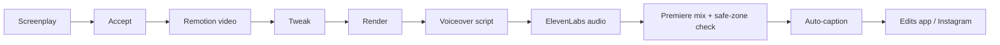

<div align="center">

# OptionXi Reels

**Instagram Reels for [OptionXi](https://optionxi.com), written as code.**
Built with [Remotion](https://www.remotion.dev/) (React + TypeScript). Tweak, re-render, ship.


<!-- Replace with a real preview: record a GIF from Remotion Studio and drop it in assets/ -->
<!--  -->

</div>

---

## Contents

- [Videos](#videos)
- [Quick start](#quick-start)
- [Rendering](#rendering)
- [Project structure](#project-structure)
- [Production pipeline](#production-pipeline)
- [Instagram safe-zone check](#instagram-safe-zone-check)
- [Sound effects](#sound-effects)
- [Adding a new reel](#adding-a-new-reel)
- [Prompt library](#prompt-library)
- [Tips](#tips)
- [Troubleshooting](#troubleshooting)
- [License](#license)

---

## Videos

| Composition ID | Topic | Source | Watch |
|---|---|---|---|
| `OptionXiReel-Intro` | Practice (virtual) trading | [`src/Reel-Intro.tsx`](./src/Reel-Intro.tsx) | _Instagram link_ |
| `OptionXiReel-Screeners` | Stock screeners: AI picks, ready-made, custom | [`src/Reel-Screeners.tsx`](./src/Reel-Screeners.tsx) | _Instagram link_ |

- Spec: 9:16, 1080 x 1920, built with safe-space margins for the Instagram UI.
- Final renders are attached to [GitHub Releases](../../releases), never committed. One tag per video, e.g. `v001-intro`.
- Composition IDs must match the `id` values registered in [`src/Root.tsx`](./src/Root.tsx).

## Quick start

**Requirements:** Node.js 18+, npm, and a recent Chrome (Remotion downloads one if missing).

```bash
git clone https://github.com/optionxi/optionxi-reels.git
cd optionxi-reels
npm install
npm run dev          # Remotion Studio with live preview
```

| Command | What it does |
|---|---|
| `npm run dev` | Open Remotion Studio |
| `npm run typecheck` | Type check the project |


Renders land in `out/` (git-ignored).

## Project structure

```
optionxi-reels/
├── public/                  # Static assets: logo, phone screenshots, audio, sfx/
├── src/
│   ├── index.ts             # Remotion entry point
│   ├── Root.tsx             # Registers all compositions (IDs live here)
│   ├── Reel-Intro.tsx       # Practice trading reel
│   └── Reel-Screeners.tsx   # Screeners reel
├── safe-screen/
│   └── instagram-reels-safe-zone.png   # Overlay for the safe-zone check in Premiere
├── out/                     # Rendered videos (git-ignored)
├── remotion.config.ts
├── package.json
└── tsconfig.json
```

## Production pipeline

From idea to Instagram:



| # | Step | How |
|---|---|---|
| 1 | **Screenplay** | Give the AI the product context (GitHub repo + website). Ask for the screenplay first, no code yet. |
| 2 | **Accept** | Review the screenplay. Only continue once it looks right. |
| 3 | **Build in Remotion** | Generate compositions with phone mockups, short text and safe-space margins. |
| 4 | **Tweak** | Preview with `npm run dev`. Ask for changes to timing, text, layout, animation. |
| 5 | **Render** | Output to `out/*.mp4`. |
| 6 | **Voiceover script** | Give the AI the video (or source). Ask for a script matched to on-screen timing, ready for ElevenLabs. |
| 7 | **Audio** | Generate the voiceover in [ElevenLabs](https://elevenlabs.io). |
| 8 | **Mix** | Premiere Pro (or any editor): render + voiceover. Run the [safe-zone check](#instagram-safe-zone-check) before export. |
| 9 | **Captions** | [auto-caption.app](https://auto-caption.app/), after the mix, so captions come from the final voiceover. |
| 10 | **Post** | Finish in Instagram Edits (music, trims) or upload straight to Instagram. |

## Instagram safe-zone check

Instagram covers parts of a Reel with its own UI: username and caption at the bottom, action buttons on the right, header at the top. Anything important there gets hidden.

[`safe-screen/instagram-reels-safe-zone.png`](./safe-screen/instagram-reels-safe-zone.png) is a 9:16 overlay marking those areas.

1. Import the PNG into Premiere.
2. Put it on the **top video track**, stretched across the whole sequence.
3. Scrub the video. Logos, text, phone mockups and captions must stay inside the safe area.
4. If something is covered, fix it in Remotion (or move the captions) and re-render.
5. **Disable or delete the overlay track before exporting**, or it gets burned into the final video.

> Captions count too. auto-caption.app lets you reposition them; move them up if they sit under Instagram's caption area.

## Sound effects

SFX are not committed. Download them and place the files in `public/sfx/`.

| File | Search for | Length |
|---|---|---|
| `whoosh.mp3` | "whoosh", "swoosh transition" | under 1s |
| `pop.mp3` | "pop", "bubble pop", "ui pop" | short |
| `tick.mp3` | "tick", "ui click soft", "checkbox" | short |
| `type.mp3` | "keyboard typing", "typing short" | about 1s |
| `click.mp3` | "mouse click" | short |
| `ding.mp3` | "notification", "ding", "message alert" | short |
| `success.mp3` | "success", "level up", "achievement" | short |
| `hit.mp3` | "cinematic hit", "impact", "logo sting" | short |

Reference them in code with `staticFile("sfx/whoosh.mp3")`.

## Adding a new reel

1. Create `src/Reel-<Name>.tsx` and export the component.
2. Register it in `src/Root.tsx` as a `<Composition>` with:
   - `id`: `OptionXiReel-<Name>`
   - `width={1080}`, `height={1920}`
   - `fps` and `durationInFrames` for your timeline
3. Drop screenshots, logo and audio into `public/` and load them with `staticFile()`.
4. Preview with `npm run dev`, then `npm run typecheck`.
5. Add a row to the [Videos](#videos) table.
6. Render, run the safe-zone check, then attach the final video to a GitHub Release.

## Prompt library

Reuse these as starting points.

<details>
<summary><b>1. Initial prompt (screenplay first)</b></summary>

```text
create a screen play for posting on social media, instagram size, with html and play,
to promote the optionxi app on playstore, about the practice trading feature

https://github.com/optionxi/optionxi-flutter-community, and optionxi.com to get context,
after generating the screenplay, generate the html, before that confirm
```
</details>

<details>
<summary><b>2. Improve the design</b></summary>

```text
add remotion, modern, give more time to optionxi, add phone mockups, more text
use safe space for insta reels
```
</details>

<details>
<summary><b>3. Voiceover script (after render)</b></summary>

```text
find the timing, add script, so i can paste to eleven labs, to generate audio
```
</details>

<details>
<summary><b>4. Libraries to mention</b></summary>

```text
Framer motion
```
</details>

<details>
<summary><b>5. Full example (Screeners reel)</b></summary>

```text
use remotion, instagram, with safe space, framer, create a video for explaining the tool,
in option Xi https://github.com/optionxi/optionxi-flutter-community

add phone mockups, phone screenshots, i can add later

the tool is, screeners, finding
1- AI picked stocks, which multiple screeners have filtered
2- Screeners - where there are volume, high break screeners, to find the stocks
3- custom screeners, where you can create your own filters, to find the specific
   stocks, like 4ema > 20ema, like that

everything in less words, layman terms, less cultured,
create a screen play for posting on social media

use playstore, 4.2 rating, 10k installs, show mockup phones with screenshots i can put,
https://play.google.com/intl/en_us/badges/static/images/badges/en_badge_web_generic.png

logo icon https://optionxi.com/assets/images/logo_xi.png
first plan the screenplay, then output the remotion,
```
</details>

## Tips

- **Plan first, code second.** Get the screenplay confirmed before any Remotion code.
- **Short text, simple words.** Half of Reels are watched on mute.
- **Respect the safe zone.** Keep key text and logos away from the top, bottom and right edges.
- **Captions last.** Only after the final mix, and inside the safe area.
- **Phone mockups.** Put screenshots in `public/`, load with `staticFile()`.
- **Pin Remotion versions.** All `remotion` and `@remotion/*` packages must match exactly (currently `4.0.539`).
- **Don't commit renders.** Use GitHub Releases.

## Troubleshooting

| Problem | Fix |
|---|---|
| `Composition not found` on render | The ID in your command doesn't match `id` in `src/Root.tsx`. |
| Version mismatch error from Remotion | Align every `remotion` / `@remotion/*` package to the same exact version, then reinstall. |
| Image or audio not loading | File must be in `public/` and referenced via `staticFile("name.ext")`, not a relative path. |
| Missing sound in render | Check the file exists in `public/sfx/` with the exact name from the [SFX table](#sound-effects). |
| Overlay visible in final export | The safe-zone track was left enabled in Premiere. Disable it and re-export. |

## License

MIT. Fork it, learn from it, make your own reels.

---

<div align="center">

Made for [OptionXi](https://optionxi.com): open-source analytics and virtual trading.

</div>